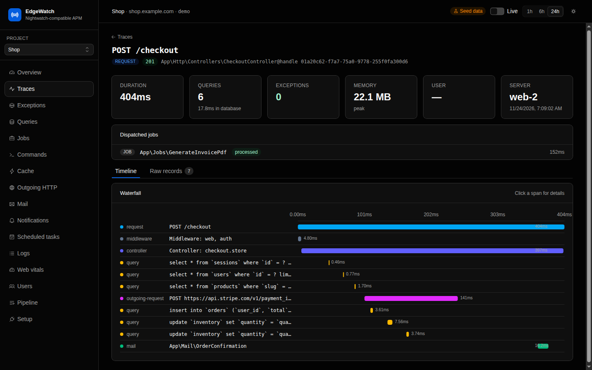

# EdgeWatch

Edge-native observability backend for Laravel on Cloudflare Workers, **wire-compatible with Laravel Nightwatch**:
point the official Nightwatch agent at EdgeWatch (`NIGHTWATCH_BASE_URL`) or use the agentless `edgewatch/laravel-edgewatch` client.
Protocol research and the exact source files it is based on: [docs/nightwatch-compat.md](docs/nightwatch-compat.md).

EdgeWatch is **single-tenant and self-hosted**: one owner runs it for their own apps. Projects are tags you switch between, not tenants.



More screenshots (overview, traces, exceptions, queries, pipeline): [docs/dashboard.md](docs/dashboard.md).

```
Laravel app --TCP (len:v1:hash:json)--> Nightwatch agent --HTTPS gzip--+
Laravel app --laravel-edgewatch (HTTPS gzip, 500ms timeout)------------+
                                                                        v
                         workers/ingest (Hono, Zod, KV keys) --Queue--> workers/consumer --> D1 (metadata) + R2 (raw traces)
                                                                                                   ^
                                  apps/dashboard (React, Vite, Tailwind) <-- workers/api (Hono) ---+
```

| Path | What |
| --- | --- |
| `packages/laravel-edgewatch` | Composer client (1.0.0, not on Packagist yet): sends all 13 Nightwatch record types (requests, queries with literals stripped, exceptions, commands, queued jobs / job attempts, scheduled tasks, cache events, outgoing HTTP, mail, notifications, logs, users). UUIDv7 trace IDs, PII redaction, buffered transport (500 records, 500 ms timeouts), honors 429/`stop`. Pest tests. |
| `packages/browser` | `@edgewatch/browser` (1.0.0, not on npm yet): dependency-free browser error reporter for EdgeWatch's own `POST /api/browser` (not part of the Nightwatch wire format). |
| `packages/shared` | TypeScript shared by the Workers: Zod schemas for every Nightwatch record type, SQL normalizer (same output as the PHP one), PII scrubber, HMAC ingest tokens, browser-event mapping. |
| `workers/ingest` | `POST /api/agent-auth` and `POST /api/ingest` (Nightwatch agent contract), `POST /api/browser`. Hashed API keys in KV, Zod validation, per-trace queue messages, 429 `stop`/`refresh_in` + `Retry-After` when rate-limited or blocked by a manual over-quota flag in KV (no usage metering). |
| `workers/consumer` | Queue consumer: normalizes SQL, computes `sql_hash`, scrubs PII, writes D1 rows and raw traces to R2 at `traces/{project_id}/{date}/{trace_id}.json`. |
| `workers/api` | API: overview, route-grouped Requests, persistent Issues, chronological Logs, traces (filters, search, range, cursor, waterfall, raw R2 trace, related job/request traces), exceptions, queries, jobs, commands, cache, outgoing requests, mail, notifications, scheduled tasks, logs, users. Full list in [CHANGELOG.md](CHANGELOG.md#endpoints). |
| `workers/migrations` | D1 schema `0001`-`0020`: traces, exceptions, queries, users, job attempts, commands, cache events, outgoing requests, mail, notifications, scheduled tasks, logs, dead letters, pipeline stats, daily usage, web vitals, issue state/history, captured route templates and the optional SQL key table. |
| `apps/server` | One Bun process (or the root `Dockerfile`) running the ingest, consumer and API code plus the dashboard, on SQLite, Postgres, MySQL or libSQL and local files or S3, for running without Cloudflare ([self-hosting](docs/self-hosting.md#single-process--docker)). |
| `apps/dashboard` | React + Vite + Tailwind v4 + [Kumo UI](https://kumo-ui.com) (`@cloudflare/kumo`, design system of record). Seed data unless `VITE_API_URL` is set (header badge shows the source); search, filters, 1h/6h/24h, 15 s live polling. |
| `examples/laravel-sandbox` | Laravel 12 app wired to the local package via a Composer path repository. |
| `scripts/` | `e2e.sh` + `e2e-records.mjs` (live local pipeline test), `fresh-laravel.sh` (fresh Laravel 12 app, EdgeWatch client or official agent), `setup-cloudflare.ts` (+ tests), `d1-migrate.sh`, `deploy.sh`. |
| `fixtures/sql-normalization.json` | Shared SQL normalization cases, run by both Pest and Vitest. |

Docs: [changelog](CHANGELOG.md) | [release checklist](docs/release-checklist.md) | [Nightwatch parity](docs/nightwatch-parity.md) | [architecture](docs/architecture.md) | [deployment](docs/deployment.md) | [self-hosting / local](docs/self-hosting.md) |
[dashboard screenshots](docs/dashboard.md) | [migrating from Nightwatch](docs/nightwatch-migration.md) | [Nightwatch wire format](docs/nightwatch-compat.md)

## Development

Requirements: [Bun](https://bun.sh) 1.4.5+ (package manager and script runner), Node 22.12+ (Wrangler and Vitest run on Node), PHP 8.2+ with Composer.

```bash
bun install
```

- **Dev:** `bun run dev:dashboard` serves the dashboard at http://localhost:5173 on seed data (set `VITE_API_URL` for a real API; the dashboard uses email/password accounts and secure session cookies; use same-origin routing for production).
  `bun run dev:ingest`, `dev:consumer`, `dev:api` run each Worker on `wrangler dev`; `bun run e2e` wires them all together.
- **Test:** `bun run test` runs Vitest in every workspace (shared, browser, ingest, consumer, api, dashboard).
  `bun run test:php` runs Pest for the Laravel package and the sandbox (run `composer install` in both first).
- **Lint:** `bun run lint` runs Biome's linter over the TypeScript sources (`biome.json`).
- **Typecheck:** `bun run typecheck` runs `tsc --noEmit` in every workspace.
- **E2E:** `bun run e2e` starts the sandbox and the three Workers locally and checks sandbox -> ingest -> queue -> consumer -> D1/R2 -> api (see [self-hosting](docs/self-hosting.md)). `bun run e2e:postgres` runs the same checks with Postgres as the event store, `bun run e2e:portable` runs them on Postgres + an S3 bucket (local moto) + SQL keys, and `bun run test:postgres` runs the Postgres adapter tests (both start a Postgres container with Docker unless `E2E_POSTGRES_URL` / `EDGEWATCH_TEST_POSTGRES_URL` is set).
- **Fresh Laravel 12 install:** `bun run fresh-laravel` creates a new Laravel 12 app in a temp dir, requires `packages/laravel-edgewatch` by path, runs `migrate`, the package Pest suite and the app tests, then sends a request, commands, a queued job, cache calls, a log line, a handled exception, an outgoing HTTP call, a mail, a notification, a scheduled task and a signed-in user to a local ingest harness and reads every record type back from the API. `bun run fresh-laravel:nightwatch` does the same with the official `laravel/nightwatch` package and its unmodified `php artisan nightwatch:agent`, pointed at EdgeWatch with `NIGHTWATCH_BASE_URL`.
- **CI:** [`.github/workflows/ci.yml`](.github/workflows/ci.yml) runs `bun install --frozen-lockfile`, typecheck, lint, Vitest, Pest, build and the two-project e2e. The [first successful hosted run](https://github.com/n3crosis/edgewatch/actions/runs/45364773853) passed; require CI on the final release commit.
- **Logs and errors:** see [architecture](docs/architecture.md#errors-and-logs).

## Several apps (projects)

EdgeWatch is **single-tenant and self-hosted**: one owner, several projects (your Laravel apps or sites). There are no
accounts, orgs, tenants or roles. `project_id` is just a tag:

- **Ingest:** one ingest key (`bun run --filter @edgewatch/ingest create-key <default-project> ingest`) can write to any project. List, rotate, revoke and audit keys with `bun run --filter @edgewatch/ingest keys` ([deployment](docs/deployment.md#4-create-api-keys)).
  Set `EDGEWATCH_PROJECT_ID=<project>` in each app's `.env`; data without a tag (e.g. from the official Nightwatch agent) goes to the
  key's default project. Using one key per app instead also works.
- **Reads:** one read key sees every project. Read endpoints take an optional project filter (`/v1/projects/:id/...` or `?project_id=`).
- **Dashboard:** a project selector in the sidebar filters every view.

Details: [architecture](docs/architecture.md#projects-single-tenant).

## Deploying

The checked-in resource IDs in `workers/*/wrangler.jsonc` belong to the project's test installation. Point them at your own
account with the setup script (placeholder rules: [deployment.md](docs/deployment.md#replace_with_-placeholders)).

```bash
export CLOUDFLARE_API_TOKEN=...   # + CLOUDFLARE_ACCOUNT_ID if the token sees several accounts
bun run setup:cloudflare --validate  # preflight: bindings, queues, URLs, token, secrets; changes nothing
bun run setup:cloudflare --dry-run   # preview; works without a token
bun run setup:cloudflare             # find-or-create KV, D1, R2, queues + DLQ, write IDs over placeholders, apply D1 migrations
scripts/deploy.sh               # workers, then the dashboard on Cloudflare Pages (needs VITE_API_URL)
```

Without Cloudflare: `docker build -t edgewatch . && docker run -p 8080:8080 -v edgewatch-data:/data edgewatch` runs everything in one container ([docs/self-hosting.md](docs/self-hosting.md#single-process--docker)).

Details: [docs/deployment.md](docs/deployment.md). For more data than D1's 10 GB, the consumer and API can use Postgres or MySQL through Hyperdrive ([docs/deployment.md](docs/deployment.md#optional-postgres-or-mysql-through-hyperdrive-instead-of-d1)), or libSQL/Turso ([docs/deployment.md](docs/deployment.md#optional-libsql--turso-instead-of-d1)).

## Release status

Version **1.0.0 is a release candidate**: not tagged, not on npm or Packagist. Every local suite passes (Vitest, Pest,
e2e on Miniflare, both fresh-Laravel scripts). Hosted CI has passed. A deploy to a real Cloudflare account remains unverified. The owner's remaining steps are in [docs/release-checklist.md](docs/release-checklist.md); the
Nightwatch parity matrix and known differences are in [docs/nightwatch-parity.md](docs/nightwatch-parity.md).

## Known limitations (not planned for 1.0)

1. **Dashboard login:** invite-only email/password accounts with owner, admin and viewer roles. Sessions use HttpOnly cookies; no credential is embedded in the bundle. Owners invite teammates and manage access in Accounts. API keys remain available for integrations. See [deployment.md](docs/deployment.md#dashboard-account-routing) for initial owner setup.
2. **Key/project management:** keys are managed with a CLI (`bun run --filter @edgewatch/ingest keys create|list|revoke|rotate|audit`), with optional expiry and an audit log in KV. There is no key UI or API. A revoked key can still pass for up to 60 s (KV edge cache), and agent tokens it already issued stay valid until `TOKEN_TTL` (1 h).
3. **Usage metering:** records are counted per project per UTC day (`/v1/usage`, Pipeline page), and an optional daily record quota (`DAILY_RECORD_QUOTA` on the consumer, or per project via `PUT /v1/projects/:id/settings`) sets the 429 `stop` until UTC midnight. Counting happens in the consumer, so records already queued when the quota is hit are still stored, and stable message receipts prevent redeliveries from being counted twice. There is no billing.
4. **Retention:** hourly D1/R2 retention uses `RETENTION_DAYS` or a per-project `retention_days` (`PUT /v1/projects/:id/settings`). The R2 lifecycle backstop from the setup script is bucket-wide, so set `EDGEWATCH_RETENTION_DAYS` to the longest retention you use (or 0). Not yet run on a real account.
5. **Real-account validation:** setup/deploy scripts and the `RATE_LIMITER` binding are untested against a real Cloudflare account. The Vitest pool bundles wrangler 4.35, which warns `Unexpected fields ... "ratelimits"` (tests inject a mock limiter); wrangler 4.166 used for dev/deploy accepts it.
6. **Security review:** seeded fuzz tests cover the ingest and browser body parsers (raw bytes, corrupt gzip, wrong shapes), record and browser-event validation, SQL normalization, PII scrubbing and ingest tokens. There has been no external review, and CORS/origin checks are only unit-tested.
7. **Load testing:** `bun run load-test` measures local Miniflare throughput (numbers in [docs/capacity.md](docs/capacity.md#local-load-test)); there are no numbers from a real Cloudflare account.
8. **Self-observability:** the Pipeline page and `/v1/pipeline` show consumer throughput, queue lag and dead letters; dead letters can be replayed, and `ALERT_WEBHOOK_URL` sends dead-letter and queue-lag alerts. Ingest-side errors (4xx/5xx) are only in Workers Logs, with no alert.
9. **Browser SDK:** breadcrumbs and Core Web Vitals are reported (averages and "good" share, no p75); no source maps or session replay.
10. **Ops:** `bun run backup:d1` dumps D1 (Time Travel covers point-in-time restore); R2 traces and KV keys need their own copies. Version policy: [docs/record-versions.md](docs/record-versions.md).
