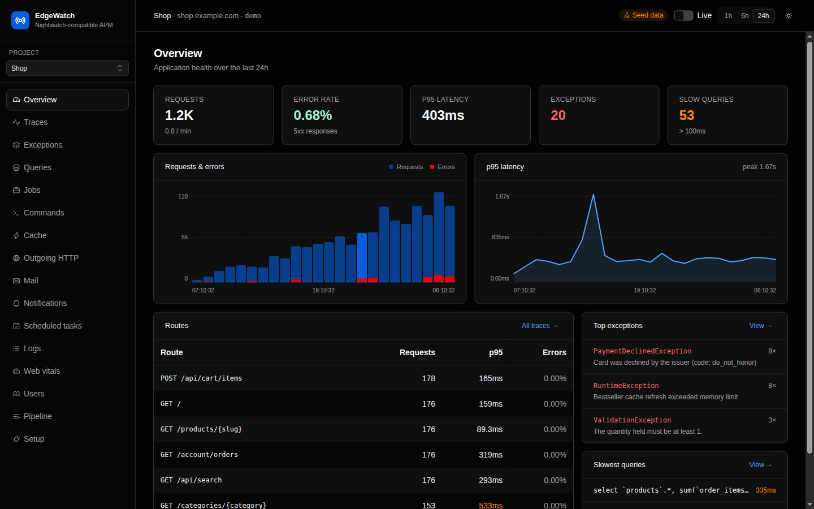
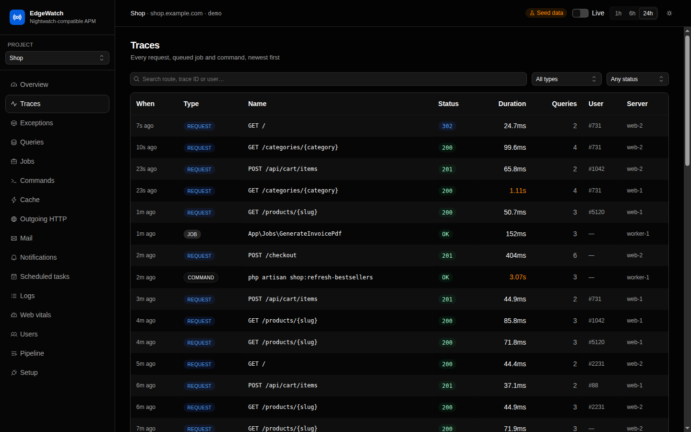
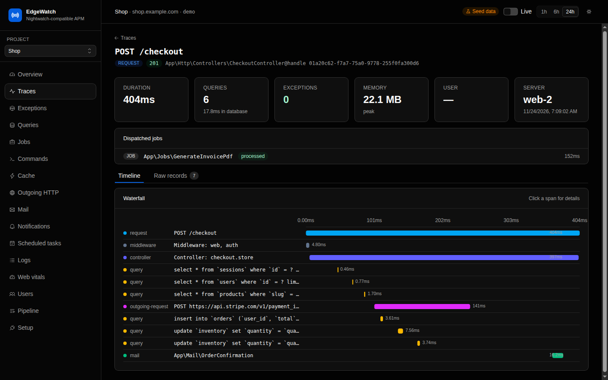
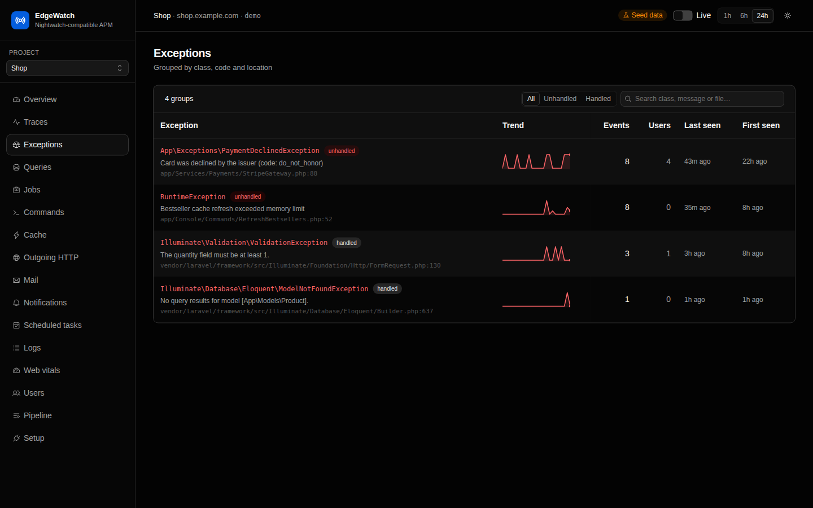
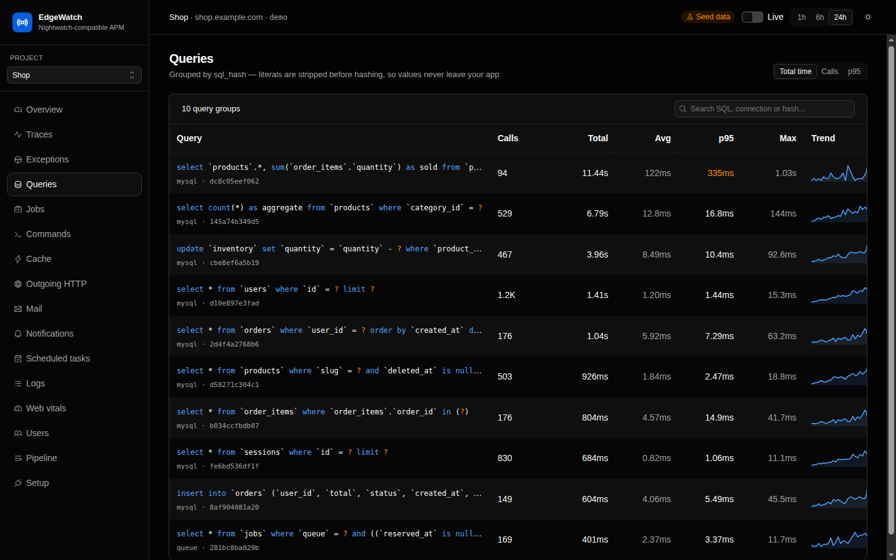
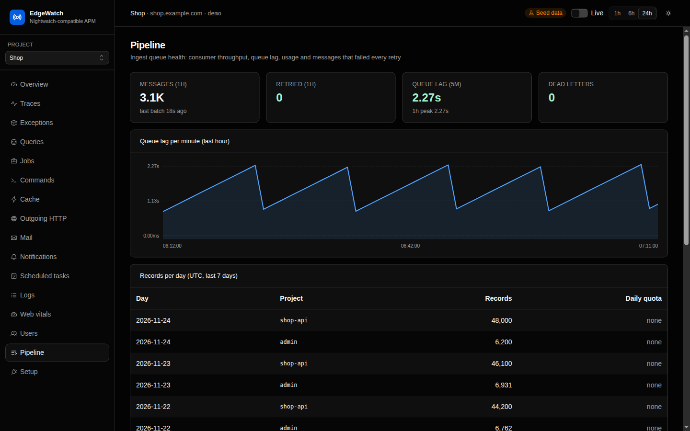

# Dashboard

The dashboard (`apps/dashboard`) is a React + Vite app built on [Kumo UI](https://kumo-ui.com). It talks to `workers/api`
(or to `apps/server` on the same origin) with a read key that it keeps in the browser. Without `VITE_API_URL` it shows
generated seed data; the screenshots below use that seed data (`cd apps/dashboard && bun run dev`), which is why the
header shows the "Seed data" badge.

## Keyboard

Press **⌘K** (macOS) or **Ctrl+K** anywhere, or click **Search** in the header, to open the command palette:

- Type to jump to a page. Matching is fuzzy and ranked: exact, then prefix, word start, substring, then letters in
  order (`ppl` finds Pipeline). Pages also match keywords such as `errors` (Exceptions) or `sql` (Queries).
- Two or more characters also search traces in the current project, environment and range (the same search as the
  Traces page); up to 6 results are listed.
- Paste a trace ID (UUID or 16+ hex characters) to open it directly.
- ↑/↓, Home/End move, Enter opens, Esc closes. Focus moves to the search field on open and returns to where it was
  on close; Tab stays inside the palette.

The palette keeps the current project, range and environment when it navigates.

## Overview

Requests, error rate, p95 latency, exceptions and slow queries for the selected range, with routes, top exceptions and
the slowest queries.

## Traces

Every request, queued job and command, newest first, with search, type/status, minimum duration, exact user ID, server and captured environment filters. Filters and relative or fixed time windows are shareable in the URL. The header environment selector scopes all investigation views, and navigation preserves the choice. Pipeline and Setup are project-wide. Issue status and history remain project-wide; issue visibility and impact counts follow the selected environment.

## Trace detail

Summary cards, dispatched jobs, and a waterfall built from the raw records stored in R2 (or S3/files). Click a span for
details; the Raw records tab shows the stored JSON.

## Exceptions

Grouped by class, code and location, with handled/unhandled filters and a trend per group.

## Queries

Grouped by `sql_hash`; literals are stripped in the app before anything is sent.

**No EXPLAIN view.** The API has no plan data to show, so the dashboard does not draw one. A query record (Nightwatch
wire format) carries the normalized SQL with `?` placeholders, the connection name, file/line and duration; it has no
bindings and no plan, and the Laravel client and the official agent do not run `EXPLAIN`. EdgeWatch cannot produce a plan
itself: it never connects to the application's database, and running `EXPLAIN` on its own event store would describe
the wrong database. `/v1/queries` therefore returns counts and timings only. A plan view would need the client to
capture plans for slow queries (sending bindings, a privacy and load trade-off), which the wire format does not have.

## Pipeline

Consumer throughput, retries, queue lag, dead letters (with replay) and records per project per day against the daily
quota.

